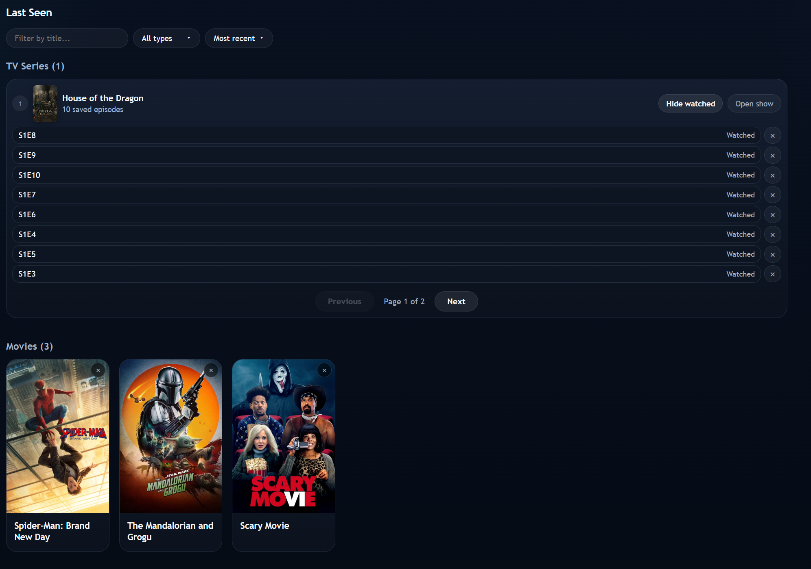
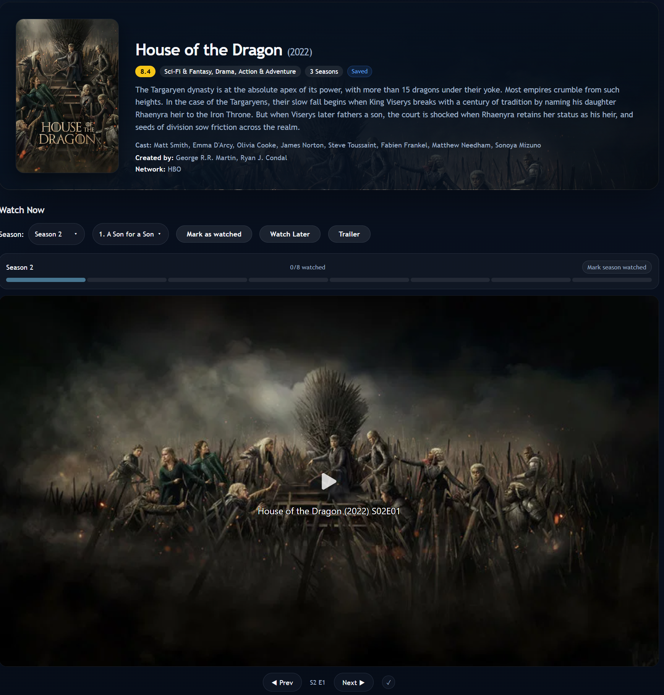
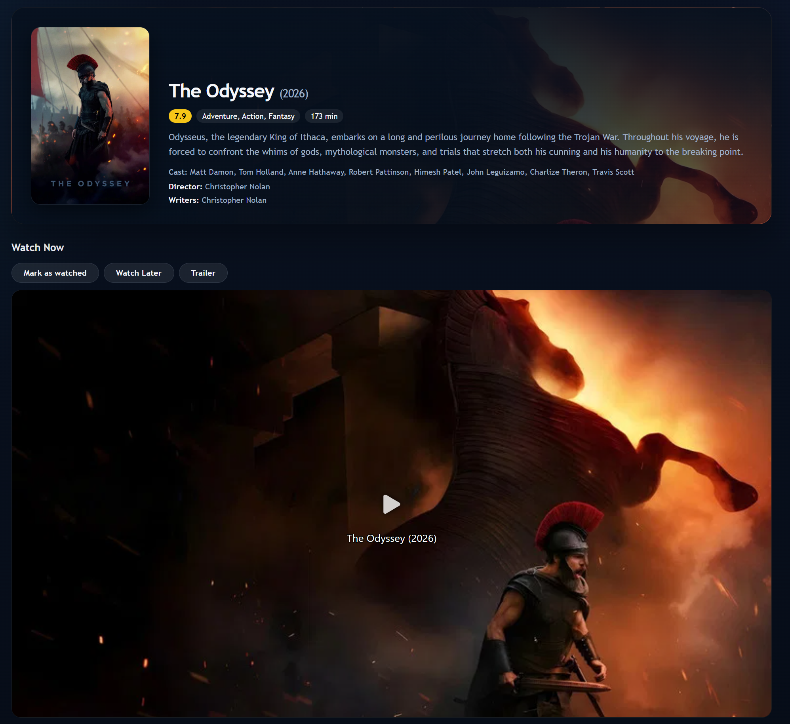
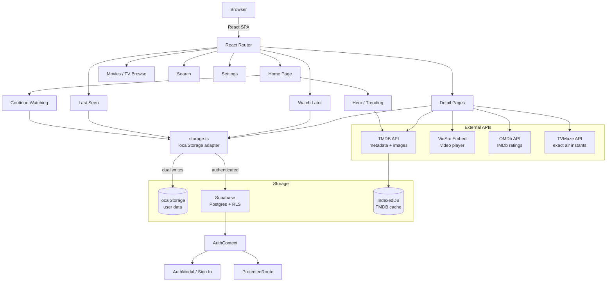

# StreamFlow

A personal streaming web app built with React and TypeScript. Browse movies and TV shows using TMDB metadata, watch via embedded players, and keep track of what you're watching. Everything works locally with no sign-up required, and an optional Supabase account syncs your library, watch history, and continue-watching list across devices.

## Screenshots

<table border="0">
  <tr>
    <td width="50%" align="center" valign="top">
      
      <br />
      <sub><b>Landing Page</b></sub>
    </td>
    <td width="50%" align="center" valign="top">
      
      <br />
      <sub><b>Last Seen</b></sub>
    </td>
  </tr>
  <tr>
    <td width="50%" align="center" valign="top">
      
      <br />
      <sub><b>TV Series View</b></sub>
    </td>
    <td width="50%" align="center" valign="top">
      
      <br />
      <sub><b>Movie View</b></sub>
    </td>
  </tr>
</table>

## Architecture



## Features

### Browsing & Watching
- **Browse** movies and TV shows with filters (genre, country, year, date range, sort order, original language, minimum vote count), on both movie and TV pages
- **Search** across movies, TV shows, and people
- **Watch** content via embedded video player
- **IMDb ratings** (OMDb) shown on cards, detail pages, and per episode; falls back to TMDB ratings where unavailable
- **Continue Watching** shows titles you have started watching but not finished, each card with two actions:
  - **Restart** (↺) drops the watching flag and resets the player to the beginning
  - **Remove** (×) drops it from Continue Watching without touching the watched mark
  - **Cross-device** (signed in) syncs which titles you're partway through — no playback position is stored locally or remotely, so every device starts from the beginning
- **Decision badges** on detail pages so you can tell what to do next without reading:
  - Series status — `Ended` or `Ongoing`
  - New episodes — `N new`, unwatched episodes of the current season that aired in the last 7 days
  - Season progress — `X/Y watched`
  - Movies show a `✓ Watched` badge
- **Auto-detect watched** episodes are marked automatically when you click Next or reach the end
- **Episode navigation** season/episode dropdowns with keyboard search, prev/next buttons
- **Keyboard shortcuts** while watching: N = next episode, P = previous episode, W = toggle watched, F = toggle fullscreen
- **Trailers** YouTube trailers on detail pages when available
- **Recommendations** "You might also like" section on movie and show detail pages
- **Background new-episode scan** detects fresh releases for your Watch Later series and marks "series watched" shows with new episodes, showing them in the notification bell (throttled to once/hour)
- **Request cancellation** in-flight API requests are cancelled on navigation to prevent stale data

### Search
- Type-ahead suggestions from your recent searches, with per-item removal
- **No-results recovery** — instead of a dead end, the empty state offers Trending / Movies / TV links plus a labelled, vertical list of your recent searches (current query excluded), each row one click to re-run and removable with `×`

### Watch Later
- Save movies, shows, or individual episodes to Watch Later
- **Sortable, filterable list** — sort by date added, title, or year (each direction), filter to movies or TV, with a Clear filters reset
- **Bulk selection** — `Select` enters a selection mode with a checkbox on every title *and* individual episode:
  - `Select page` selects everything visible, `Clear` empties the selection
  - `Remove selected (N)` turns into an inline `Confirm remove (N)` / `Keep` step — no modal
  - Per-card `×` buttons hide while selecting so the checkbox isn't competing for the same corner
  - `Escape` exits selection mode and discards the selection
- **Upcoming releases** panel, open by default, grouped by broadcast day
- **Release Calendar** shows upcoming releases from your library:
  - Month grid with poster thumbnails on release days
  - **Heatmap effect** — busier days glow progressively brighter
  - **Past days** are greyed out to show the date has passed
  - **Adaptive posters** — posters scale up when a day has few releases and shrink to fit when it's busy
  - Day panel with modern release cards (poster + title + episode info + Open)
  - Entrance animations, staggered grid cascade, and loading skeletons
- **Calendar timezone** — releases are bucketed on the day they land on *where you are*, not in UTC; set it in Settings. Episodes with a known exact broadcast instant (via TVMaze) use that instant, so a 00:30 UK premiere shows on the correct date
- **Duplicate guarantee** — every rendered list (grid, upcoming, calendar, counts) is deduped from a single source, so the same title can't appear twice

### Accounts & Sync (optional)
- **Guest mode** — browse, search, and watch everything with no account; personal features (Watch Later, Last Seen, Notifications, Settings) prompt a sign-in
- **Sign In / Register** via a global modal (forgot-password flow included) with focus trap, scroll lock, and Escape/outside-click to close
- **Cloud sync** — watched marks, watch later, search history, and Continue Watching metadata (which titles you're partway through) sync to Supabase with Row Level Security (video source and notifications stay local-only; playback position is never stored)
- **Local-first storage** — every write goes to localStorage instantly and to Supabase in the background; the app is fully functional offline or without Supabase configured
- **Offline resilience** — failed sync writes are queued and retried with exponential backoff
- **One-time migration** — after signing in, local data is uploaded to the cloud and the app continues reading from localStorage
- **Backup & restore** — export/import your data as JSON, both local and cloud versions

### Polish
- **Last Seen** view your watch history grouped by series
- **Actionable empty states** — Watch Later, Last Seen, and Search all explain what the screen is for and link somewhere useful (Browse Movies, Explore TV Shows, Browse Trending) instead of showing a dead end
- **Unified player controls** — movie and episode players use the same icon bar, with a Restart control that remounts the player from 0:00
- **Settings** — card-based sections for account, default video source, calendar timezone, storage (clear history / watching flags / watch later / TMDB cache / offline queue), statistics, backup, and a danger zone
- **Error boundary** catches render crashes with retry button and error logging
- **Back to top** floating button appears after scrolling down
- **Accessibility** ARIA roles, labels, skip-to-content link, keyboard navigation, screen reader announcements, tooltips on every decision badge
- **Dark theme** with responsive layout
- **Loading skeletons** with shimmer animations across grids, history, and the release calendar

## Tech Stack

- [React 19](https://react.dev) + [Vite](https://vite.dev) + TypeScript
- [React Router](https://reactrouter.com) for client-side routing
- [TMDB API](https://developer.themoviedb.org) for metadata, images, and search
- [OMDb API](https://www.omdbapi.com) for IMDb ratings (cards, detail pages, episodes)
- [TVMaze API](https://www.tvmaze.com/api) for exact episode air instants (no key required)
- [VidSrc](https://vidsrc.fyi) for video embeds
- [Supabase](https://supabase.com) for optional authentication and cloud sync (Postgres + RLS)
- CSS Modules for scoped styling
- localStorage for local user data (watched marks, watching flags, watch later lists)
- IndexedDB for TMDB API response cache (larger quota than localStorage)
- [Vitest](https://vitest.dev) for unit and component tests (jsdom, mocked externals)
- [oxlint](https://oxc.rs) for linting, with `react/rules-of-hooks` and `react/exhaustive-deps` enabled

## Getting Started

### Prerequisites

- Node.js 20.19+ (or 22.12+)
- A free [TMDB API key](https://www.themoviedb.org/settings/api)
- Optional: a free [OMDb API key](https://www.omdbapi.com/apikey.aspx) for IMDb ratings
- Optional: a free [Supabase project](https://supabase.com) for accounts + cloud sync

### Setup

```bash
git clone https://github.com/AdeiTamayo/StreamingPlatform.git
cd StreamingPlatform
npm install
```

Create a `.env` file in the project root (see `.env.example`):

```
VITE_TMDB_API_KEY=your_tmdb_api_key_here
VITE_OMDB_API_KEY=your_omdb_api_key_here        # optional, enables IMDb ratings
VITE_SUPABASE_URL=your_supabase_project_url   # optional
VITE_SUPABASE_ANON_KEY=your_supabase_anon_key # optional
```

`VITE_OMDB_API_KEY` is optional — without it the app shows TMDB ratings instead. `VITE_SUPABASE_URL` and `VITE_SUPABASE_ANON_KEY` are optional — without them the app runs entirely in local-only mode (no sign-in).

### Setting up Supabase (optional)

1. Create a project at [supabase.com](https://supabase.com)
2. In the SQL editor, run the migrations in order:
   - `001_initial_schema.sql` — creates the `watched`, `watch_later`, and `search_history` tables with their indexes, unique constraints, and Row Level Security policies, and drops any legacy `settings` / `notifications` tables
   - `002_search_history_unique_index.sql` — dedupes search history and adds its unique index
   - `003_progress_table.sql` — creates the `progress` table for cross-device Continue Watching metadata (media identity only, never playback time)
   - `004_security_hardening.sql` — adds `WITH CHECK` to the UPDATE policies, write-size constraints (`NOT VALID` so legacy rows are unaffected), per-user row caps enforced by triggers, and revokes table access from the `anon` role

   All of them are idempotent, so re-running them is safe.
3. Copy your project URL and anon key into `.env`

   Migrations already applied to a hosted project are **not** re-run when you edit the file — add a new numbered migration instead. `supabase db push` applies pending files if you use the Supabase CLI.

### Migrating existing local data

If you already used the app before adding Supabase, run:

```bash
TRANSFER_EMAIL="you@example.com" TRANSFER_PASSWORD="..." npm run transfer:supabase
```

The credentials come from the environment, not the command line — arguments would be visible in shell history and process listings.

This prints a snippet to paste into the browser console while on the app, which uploads your existing localStorage data to your account (or just sign in — the app attempts this migration automatically on login).

### Build

```bash
npm run build
```

Output goes to the `dist/` directory.

### Tests

```bash
npm run test
```

339 tests across 33 files, run with [Vitest](https://vitest.dev) in a jsdom environment. TMDB/OMDb/TVMaze and Supabase calls are mocked, so the suite never touches the network.

```bash
npm run typecheck  # tsc -b (also covers vite.config.ts and scripts/)
npm run lint       # oxlint
npm audit          # dependency vulnerabilities (currently 0)
```

## Deploying to Vercel

This project is ready for Vercel deployment. The `vercel.json` configures SPA routing (all routes redirect to `index.html`).

1. Push to GitHub
2. Import the repo on [vercel.com](https://vercel.com)
3. Add `VITE_TMDB_API_KEY`, optionally `VITE_OMDB_API_KEY`, `VITE_SUPABASE_URL` + `VITE_SUPABASE_ANON_KEY`, as environment variables in the Vercel dashboard
4. Deploy

Vercel will auto-deploy on every push to `main`.

`vercel.json` also sets the security headers for every response: a Content-Security-Policy (self-only scripts/objects, explicit API `connect-src` list, `frame-ancestors 'none'`), HSTS, `X-Content-Type-Options`, `Referrer-Policy`, `Permissions-Policy`, `X-Frame-Options` and `Cross-Origin-Opener-Policy`.

Production-hygiene notes:

- Scope `VITE_*` variables **per environment** (Production / Preview / Development) in the Vercel dashboard. Give previews their own Supabase URL + anon key if you have them, so test work shares a project with test data only.
- Preview deployments are public URLs by default — enable **Deployment Protection** (password or SSO) on Vercel if a branch build should not be reachable by anyone with the link.
- Vercel ignores `.env*`, `dist`, `node_modules`, `screenshots` etc. via `.vercelignore`.

Note: everything prefixed `VITE_` ships to the browser. Never put a server-side
secret in this project — there is no server to keep it safe.

## Project Structure

```
src/
  api/
    tmdb.ts             # TMDB API calls with caching + AbortSignal support
    omdb.ts             # OMDb IMDb rating lookups (per-episode + by title), cached in localStorage
    vidsrc.ts           # Embed URL builders
    storage.ts          # Local-first data adapter (localStorage + Supabase dual writes)
    storageBackup.ts    # Export/import Supabase data as JSON
    tvmaze.ts           # Exact episode air instants + "is it released yet" checks
    tmdbCache.ts        # IndexedDB cache for TMDB API responses
    tvStatusCache.ts    # Cache for TV airing status
    newEpisodeScan.ts   # Background new-episode detection for Watch Later series
  repositories/
    watchedRepository.ts       # Supabase writes for watched marks
    watchLaterRepository.ts    # Supabase writes for watch later lists
    searchHistoryRepository.ts # Supabase writes for search history
    progressRepository.ts      # Supabase writes for Continue Watching metadata
  services/auth/
    authService.ts      # Supabase auth wrapper (sign in/up/out, reset password, session)
  context/
    AuthContext.tsx     # Auth state + global auth modal state
  components/
    Navbar.tsx          # Sticky top navigation with sidebar (guest vs signed-in)
    AuthModal/          # Global sign-in modal: Login, Register, ForgotPassword forms
    ProtectedRoute/     # Gates personal pages behind auth, opens modal for guests
    AccountButton/      # "Sign In" CTA for guests
    Player.tsx          # Video player with watching/completion detection
    MediaCard.tsx       # Poster card with rating and action buttons
    RatingBadge.tsx     # Shared IMDb-or-TMDB rating badge (MediaCard + Watch Later)
    ErrorBoundary.tsx   # Render crash catcher with retry
    Toast.tsx           # Toast notification system
    Notifications.tsx   # In-app notification bell
    SeasonDropdown.tsx / EpisodeDropdown.tsx / FilterDropdown.tsx / FilterBar.tsx / TypeToggle.tsx / DatePickerField.tsx / CollectionSkeleton.tsx
    MediaCarousel.tsx / BulkSelectBar.tsx / Pagination.tsx / PersonList.tsx
  pages/
    Home.tsx            # Hero carousel + Continue Watching (restart/remove) + Trending
    MovieDetail.tsx     # Movie detail with badges, player, trailer, recommendations
    TVDetail.tsx        # TV detail with status/new-episode/progress badges, season/episode nav
    MediaBrowse.tsx     # Unified browse for movies and TV shows
    Search.tsx          # Multi-search, suggestions, and no-results recovery
    WatchLater.tsx      # Saved items, bulk selection, upcoming list + release calendar
    LastSeen.tsx        # Watch history grouped by series
    Settings.tsx        # Card-based settings: account, video, storage, backup, stats
    NotFound.tsx        # 404 page
  hooks/
    useAuth.ts          # Access auth state from components
    useSearchFilter.ts  # Shared debounced fetch + pagination hook
    useAbortController.ts # Auto-abort in-flight requests on unmount
    useClickOutside.ts  # Detect clicks outside a ref
    useDropdownSearch.ts # Keyboard-driven type-to-search
    useDropdownKeys.ts  # Arrow-key + Enter navigation for dropdowns
    useTVStatus.ts      # TV airing status logic
  pages/__tests__/   # Watch Later sorting/selection, calendar, Home, Search, empty states
  test/
    setup.ts          # jsdom setup + TMDB fetch mock
    detailPages.test.tsx # Detail page render, player controls, badges, restart
  utils/
    retry.ts            # Exponential backoff retry helper
    offlineQueue.ts     # Queues failed sync writes for later retry
    dataMigration.ts    # Local → cloud data migration on login
    logger.ts           # Debug and error logging to localStorage
  lib/
    supabase.ts         # Lazy Supabase client (safe when env vars are missing)
  types/
    database.ts         # Typed Supabase database schema
  styles/
    shared.css          # Global shared styles
  config.ts             # Environment variable setup
supabase/migrations/
  001_initial_schema.sql  # watched / watch_later / search_history: tables, indexes, RLS
  002_search_history_unique_index.sql  # Dedupe search history + its unique index
  003_progress_table.sql  # Continue Watching metadata (media identity only)
scripts/
  transfer-localstorage-to-supabase.ts  # One-time data transfer helper
```

Co-located API tests sit next to their modules (`api/storage.test.ts`, `api/tvmaze.test.ts`, `api/omdb.test.ts`, `api/vidsrc.test.ts`, `api/newEpisodeScan.test.ts`); page and component tests live in `__tests__/` folders.

## Security

**Enforced in this repo:**

- **Per-account local data** — localStorage is tagged with `streamflow_data_owner`; signing out or switching accounts clears the previous account's mirrored rows (offline queue and migration flags survive) so a shared browser cannot leak one account's library to another.
- **RLS hardening** (`004_security_hardening.sql`) — UPDATE policies carry a matching `WITH CHECK` (rows cannot be reassigned to another user), write-size constraints bound titles/posters/`meta`, triggers cap rows per user (10k watched, 5k watch-later/progress, 100 searches), and table access is revoked from `anon`.
- **Auth** — 12-character minimum with upper/lowercase, number and symbol (client-side feedback; the server remains the authority); sign-up and password-reset respond the same whether or not an address exists, so the UI is not an email-enumeration oracle.
- **Player** — the embed iframe is sandboxed and sends no referrer; `postMessage` events are ignored unless they come from a known player origin.
- **Headers** — CSP and the rest are set in `vercel.json` (see "Deploying to Vercel").
- **Self-hosted fonts** — Inter and Plus Jakarta Sans are vendored in `public/fonts/`; no request ever goes to Google Fonts, and the CSP is `font-src 'self'`.
- **Logs** — `app_errors` / `player_debug` redact JWT-shaped strings, email addresses and `token=`/`password=`-style values.
- **Backups** — import rejects files over 5 MB, more than 20k entries, or more rows than the server-side caps will accept.

**Dashboard checklist (code cannot do these):**

1. Supabase → Auth → Password settings: minimum length 12, require letters + numbers (+ symbols if available), and enable leaked-password protection if your plan has it.
2. Supabase → Auth → URL Configuration: set the Site URL and an **allow list** limited to your own domains (e.g. `https://your-domain.com/*`). The app builds reset/confirm links from `window.location.origin`, so restricting this list prevents token links pointing elsewhere.
3. For a personal deployment: consider disabling public sign-ups (Supabase → Auth → Providers → Email) so only accounts you create can log in.
4. Account deletion: Supabase → Auth → Users → delete the user; every row in `watched` / `watch_later` / `search_history` / `progress` is removed by `on delete cascade`.
5. API keys are intentionally public (`VITE_*` is inlined into the bundle). TMDB's key carries your quota — if abuse shows up as rate-limit 429s, rotate the key. If you ever want a true proxy you need a server, which this app does not have.

Verify after deploy:

```bash
curl -sI https://your-domain.com | grep -iE 'content-security-policy|strict-transport'
```

## Notes

- All data is stored locally in your browser — accounts and a Supabase server are optional
- Without Supabase configured, the app works exactly as before: no accounts, no server
- Supabase data is protected by Row Level Security — each user can only read/write their own rows
- TMDB API responses are cached in IndexedDB for 24 hours (max 100 entries, virtually unlimited space)
- All `VITE_*` variables are inlined into the client bundle by design — there is no server-side secret. The Supabase key is `anon`-role and bounded by Row Level Security, and the TMDB token has no quota isolation, so it can be extracted and used to burn the account's rate limit
- Playback position is never stored (embeds rarely report it reliably), so Continue Watching tracks only that a title was started; playback always begins at 0:00 and Restart simply clears the flag
- The `N new` badge uses TMDB's date-only `air_date`, while the calendar uses TVMaze's exact air instant; near midnight they can occasionally disagree
- The app uses a privacy-conscious setup: noindex tags, no analytics, no tracking
- Video playback quality and availability depend on the embed source
- Errors are logged to localStorage under `app_errors` for debugging, with JWT-shaped strings, email addresses and `password=`/`token=`-style values redacted before storage

## License

This project is for personal use. Check the terms of service for TMDB, VidSrc, and Supabase before deploying publicly.
